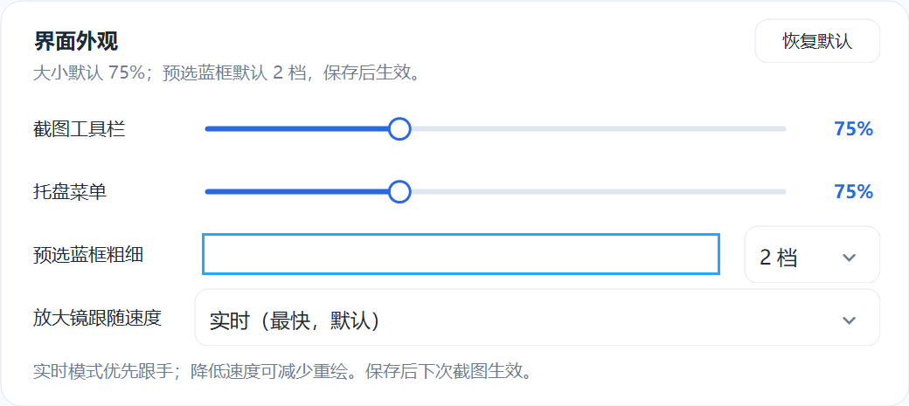

# LightCapture · 轻截

A screenshot and annotation tool that lives in the Windows system tray. Capture an area, annotate it, then copy or save the result. Also includes pinned images, scrolling captures, on-device OCR, configurable text translation, and region recording.

[中文](README.md) | **EN**

[](https://github.com/LAN-TINA-WS/LightCapture/releases)
[](https://github.com/LAN-TINA-WS/LightCapture/releases)
[](https://github.com/LAN-TINA-WS/LightCapture/stargazers)
[](#requirements)
[](https://github.com/LAN-TINA-WS/LightCapture/releases/download/v0.3.2/LightCapture-0.3.2-win-x64-portable.zip)
[](#build-from-source)
[](LICENSE)

> [Download for Windows](https://github.com/LAN-TINA-WS/LightCapture/releases/download/v0.3.2/LightCapture-0.3.2-win-x64-portable.zip) · [Release notes](https://github.com/LAN-TINA-WS/LightCapture/releases) · [Report an issue or suggest a feature](https://github.com/LAN-TINA-WS/LightCapture/issues)

Current version: **0.3.2 · Preview**. Built with C#, WinForms, and .NET 10. Project-owned source code is available under the [MIT license](LICENSE).

The application currently uses a Simplified Chinese interface. The language links above switch the documentation.

## Download the portable app

Get `LightCapture-0.3.2-win-x64-portable.zip` from [Releases](https://github.com/LAN-TINA-WS/LightCapture/releases), extract the entire folder, and run `LightCapture.exe`. The portable package includes the .NET runtime. Configure FFmpeg separately for recording and GIF export.

The release also provides a source archive and `SHA256SUMS.txt`. This is a preview build; the validation scope and remaining desktop checks are described below.

## Interface previews

These control previews use synthetic content:


<details>
<summary>Translation backend settings</summary>


</details>

## Features

- **Capture and selection:** rectangles, window preselection, polygon selections, a magnifier and color picker, and selection movement and resizing.
- **Annotations:** rectangles, ellipses, arrows, freehand strokes, text, numbered markers, and mosaic redaction, with up to 100 undo steps and redo. Mosaic brush diameter and block size are independent.
- **Image output:** image clipboard data and PNG, JPEG, or BMP files. The clipboard currently contains image formats rather than file-drop data.
- **Pinned images and editing:** always-on-top image windows, opacity, dragging and resizing, and annotation of local images.
- **Scrolling captures:** manual or timed frame collection with vertical overlap matching.
- **On-device OCR:** recognizes text using installed Windows language components. Results can be edited, copied, or exported to TXT and Word.
- **Text translation:** MyMemory, OpenAI-compatible endpoints, and DeepL, with endpoint, model, and key settings and a connection test.
- **Region recording:** MP4 and GIF output with separate system-audio and microphone controls. Requires FFmpeg.
- **Appearance settings:** record a global shortcut, size the capture toolbar and tray menu independently, and adjust the window preselection border and magnifier follow speed.

## Requirements

- Windows 10 version 2004 or newer, x64.
- .NET SDK 10 to build from source. Self-contained portable builds include the runtime.
- Installed Windows OCR components for the languages you need.
- FFmpeg for recording, GIF export, and the full encoder checks. See [encoder setup](tools/README.md).

Program and offscreen control checks have primarily run on Windows 11. Multi-monitor setups, mixed DPI, physical audio devices, and complete desktop workflows still need further testing.

## Quick start

Run `LightCapture.exe`. It starts in the system tray. Left-click the tray icon to capture; right-click it to open the feature menu.

| Shortcut | Action |
|---|---|
| Ctrl+Alt+A | Start a capture; configurable in Preferences |
| Ctrl+Enter | Finish and copy, or commit text while editing |
| Ctrl+S | Save the image |
| Ctrl+Z / Ctrl+Y | Undo / redo |
| Ctrl+T | Pin the image |
| Delete | Delete the selected annotation |
| Arrow keys / Shift+arrow keys | Move by 1 / 10 pixels |
| C | Copy the HEX color under the pointer |
| Right mouse button | Cancel the capture; the tray process keeps running |
| Esc | Cancel text entry or leave the current capture operation |

Choose **退出轻截** (Exit LightCapture) from the tray menu to stop the background process. Start with Windows is off by default and can be enabled in **偏好设置** (Preferences). Exit the old process before running an updated build; the single-instance mechanism otherwise forwards the launch request to the running version.

## Magnifier follow speed

Open **偏好设置 → 界面外观 → 放大镜跟随速度** (Preferences → Appearance → Magnifier follow speed). Choose **实时** (Real-time), **快速** (Fast), **标准** (Standard), or **省电** (Power saving). Real-time is the default. Save to apply it to the next capture; restoring appearance defaults also restores real-time following.

Real-time mode prioritizes a prompt response; slower modes reduce repaint frequency. Moving the magnifier repaints its previous and new areas and reuses text layouts and monitor information. Color picking and selection use the current mouse position. Actual responsiveness depends on the device and system paint scheduling.

Dragging a rectangular selection repaints changed bright and shaded areas, old and new borders, and size labels. Cached shaded and original images reduce full-screen copying and repeated mask blending. Moving and resizing selections use the same approach; polygon updates retain a region covering changes inside the polygon.

<details>
<summary>View follow-speed settings</summary>



</details>

## Translation settings

Open **偏好设置** (Preferences) and scroll to **翻译后端** (Translation backend):

| Backend | Configuration |
|---|---|
| MyMemory | Default public endpoint; no API key required |
| OpenAI-compatible | API base URL or complete `/chat/completions` URL, model name, and API key; local endpoints without authentication may leave the key empty |
| DeepL | API Free or Pro account type and API key |

Compatible mode uses the Chat Completions protocol. Enter a model supported by your endpoint; for example, the official API base URL is `https://api.openai.com/v1`. Models are not chosen automatically. Source and target choices include English, Simplified Chinese, Japanese, Korean, French, German, and Spanish. A request is limited to 10,000 characters.

**测试连接** (Test connection) uses the current form settings to translate the fixed sentence `Hello world.`. It may count toward service usage and can be canceled. Switching backends preserves their separate settings. After saving, new requests use the new configuration; in-flight requests keep their original configuration. Failures preserve the original text and do not forward it to another service.

## Data and privacy

- Capture and on-device OCR do not upload images. Translation sends text only to the selected endpoint.
- Translation keys are encrypted with Windows DPAPI for the current account and masked in the interface. Re-enter them after changing Windows accounts.
- Settings and error logs are stored under `%LOCALAPPDATA%/LightCapture/`; recording caches use its `recordings/` subfolder.
- Closing a recording result does not automatically delete its cache. Manage these files manually when needed.
- The source repository excludes personal settings, user keys, runtime logs, recording caches, and local build output.

## Build from source

Run in PowerShell on Windows:

```powershell
dotnet restore .\LightCapture.csproj
dotnet build .\LightCapture.csproj -c Release
.\bin\Release\net10.0-windows10.0.19041.0\LightCapture.exe
```

FFmpeg is not included in the source repository. You can build and use capture, editing, and OCR without it. To produce the public portable package, commit your source changes and supply a local encoder for the synthetic checks:

```powershell
.\package-release.ps1 -EncoderPath 'C:\Tools\ffmpeg.exe'
```

This publishes a self-contained Windows x64 app, runs the program and interface checks, and creates portable and source ZIPs, a checksum file, and a build manifest. The test encoder is excluded from the public ZIP. The script does not upload assets or create a remote release.

For a local build that bundles an encoder, put it in the project's `tools` folder as described in [encoder setup](tools/README.md), then run:

```powershell
.\build.ps1
```

The local full build produces `dist/LightCapture-<version>-win-x64/` and a ZIP that includes the supplied encoder. If you distribute that package, you must address the encoder's applicable license and corresponding-source requirements. Build scripts do not publish files automatically.

## Validation and known limitations

Current local validation records include 41 program checks, 12 toolbar cases, and 114 interface cases passing. New selection checks include 80 frame comparisons across four DPI scales and a large 4K selection, covering reversed drags, zero width or height, screen edges, movement, resizing, annotations, polygons, and coalesced repaints. Synthetic paint timings do not measure real desktop input latency. Translation protocols use mocked HTTP responses; test real endpoints with your own configuration. Recording checks use synthetic video and audio.

Desktop capture, multi-monitor and mixed-DPI setups, cross-application paste, physical audio devices, and long recordings need further real-world testing. Scrolling capture currently stitches downward only. Recording pause, manual audio-device selection, HDR correction, and image-editor cropping are not implemented. Existing annotations in imported images are not reconstructed as editable objects.

See the [contribution guide](CONTRIBUTING.md) for verification commands and development conventions, [implementation and validation scope](IMPLEMENTATION.md) for details, and the [changelog](CHANGELOG.md) for version history. These supporting documents currently use Simplified Chinese.

## License and dependencies

Project-owned source is provided under [MIT](LICENSE). Third-party components and services retain their own licenses or terms; see [third-party notices](THIRD-PARTY-NOTICES.md). Distributing binaries that include third-party components requires their license notices and applicable source availability arrangements.

- [NAudio](https://github.com/naudio/NAudio): audio processing, MIT.
- [FFmpeg](https://ffmpeg.org/): encoding through a separate process; its license depends on the chosen build.
- [.NET](https://github.com/dotnet/runtime) and [Windows OCR](https://learn.microsoft.com/en-us/uwp/api/windows.media.ocr.ocrengine).
