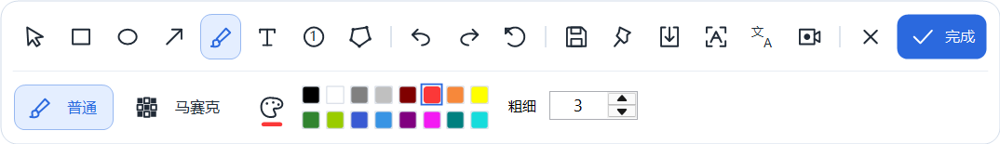
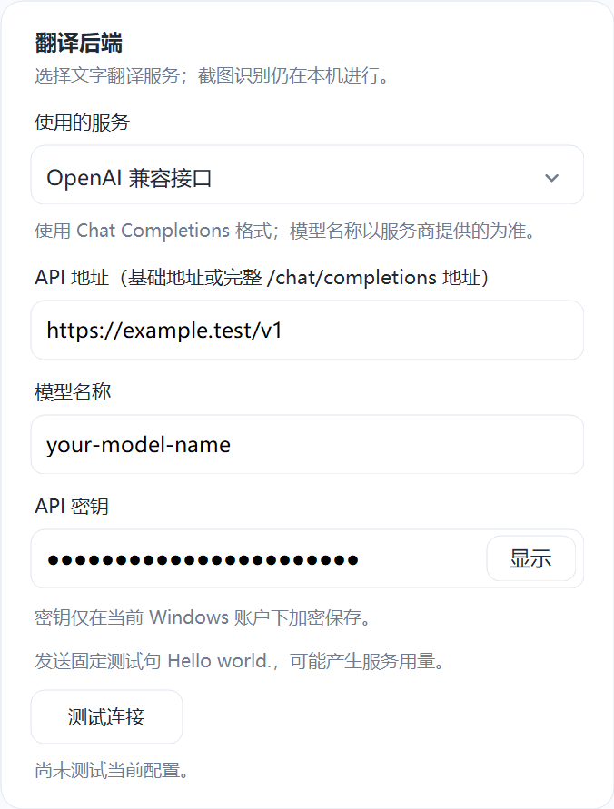

# 轻截 LightCapture

常驻 Windows 系统托盘的截图与标注工具。按快捷键选区、编辑、复制或保存，也支持贴图、滚动长截图、本机文字识别、可配置文字翻译和区域录屏。

当前版本：**0.3.0 · 试用版**。使用 C#、WinForms 与 .NET 10 开发，项目自身源码采用 [MIT 许可](LICENSE)。

## 下载便携版

从 [Releases](https://github.com/LAN-TINA-WS/LightCapture/releases) 下载 `LightCapture-0.3.0-win-x64-portable.zip`，完整解压后运行 `LightCapture.exe`。便携包包含.NET运行时；录屏与GIF导出所需的FFmpeg需在设置中单独配置。

发布页同时提供源码包与 `SHA256SUMS.txt`。这是试用版本，真实桌面与音频设备的验证范围见下文。

## 界面预览

以下为使用合成内容生成的控件预览：



<details>
<summary>查看翻译后端设置</summary>



</details>

## 功能

- **截图与选区**：矩形、窗口预选、多边形选区，放大镜取色，选区移动和缩放。
- **图片标注**：矩形、椭圆、箭头、画笔、文字、序号和马赛克，最多100步撤销／重做。马赛克笔刷大小与颗粒大小分别调整。
- **图片输出**：图片剪贴板，以及 PNG、JPEG、BMP 文件保存。当前剪贴板不提供文件粘贴格式。
- **贴图与编辑**：浮窗置顶、透明度、拖动缩放，打开本地图片继续标注。
- **滚动长截图**：手动或定时追加，识别垂直重叠区域。
- **本机 OCR**：通过 Windows 已安装的语言包识别文字，结果可编辑、复制及导出 TXT／Word。
- **文字翻译**：MyMemory、OpenAI 兼容接口与 DeepL，支持自定义地址、模型和密钥，以及连接测试。
- **区域录屏**：MP4、GIF，系统声音和麦克风分别控制，需要另行配置 FFmpeg。
- **界面设置**：录入全局快捷键；截图工具栏与托盘菜单独立缩放；调整窗口预选蓝框粗细。

## 运行环境

- Windows 10 2004 或更新的 x64 系统。
- 从源码构建需要 .NET SDK 10；自包含便携构建无需另外安装 .NET 运行时。
- OCR 需要系统已安装相应语言的文字识别组件。
- 录屏、GIF导出及完整编码测试需要 FFmpeg，配置方法见 [工具说明](tools/README.md)。

目前主要在 Windows 11 上进行程序及离屏控件验证。多显示器、混合 DPI、实际音频设备与完整桌面操作仍需进一步实机验证。

## 快速开始

构建后运行 `LightCapture.exe`，程序默认进入系统托盘。左键托盘图标截图，右键打开功能菜单。

| 快捷键 | 操作 |
|---|---|
| Ctrl+Alt+A | 开始截图，可在偏好设置中修改 |
| Ctrl+Enter | 完成并复制；输入文字时提交文字 |
| Ctrl+S | 保存图片 |
| Ctrl+Z / Ctrl+Y | 撤销／重做 |
| Ctrl+T | 贴图 |
| Delete | 删除选中标注 |
| 方向键 / Shift+方向键 | 移动1／10像素 |
| C | 复制指针处的 HEX 色号 |
| 鼠标右键 | 取消本次截图，程序继续在托盘中运行 |
| Esc | 取消文字或退出当前截图操作 |

点击托盘“退出轻截”结束后台进程。开机启动默认关闭，可在偏好设置中开启。更新版本前先退出旧进程，避免单实例机制将新启动请求交给旧版。

## 翻译设置

打开“偏好设置”，向下滚动到“翻译后端”：

| 后端 | 配置 |
|---|---|
| MyMemory | 默认公共接口，无需密钥 |
| OpenAI 兼容接口 | API基础地址或完整的 `/chat/completions` 地址、模型名称、API密钥；本地无鉴权服务可留空密钥 |
| DeepL | API Free／Pro 账户类型与 API 密钥 |

兼容模式使用 Chat Completions 协议。模型名称需与所填服务匹配；例如，官方基础地址可填 `https://api.openai.com/v1`。不自动选择模型。支持英语、简体中文、日语、韩语、法语、德语和西班牙语的源／目标语言选择，单次最多一万字符。

“测试连接”使用当前表单配置发送固定句子 `Hello world.`，可能产生服务用量，可随时取消。切换后端保留各自参数；保存后新请求使用新配置，进行中的请求保持原配置。失败时保留原文，不自动转发给另一服务。

## 数据与隐私

- 截图与本机 OCR 不上传图片。使用翻译时，仅向所选后端发送文字。
- 翻译密钥用 Windows DPAPI 绑定当前账户加密保存，界面默认隐藏；更换账户后需要重新填写。
- 设置与错误日志存储在 `%LOCALAPPDATA%/LightCapture/`，录屏缓存位于其 `recordings/` 子目录。
- 录屏缓存不会在关闭结果页时自动删除，需要时可手动管理。
- 源码仓库不包含个人设置、用户密钥、运行日志、录屏缓存和本机编译结果。

## 从源码构建

在 Windows PowerShell 中执行：

```powershell
dotnet restore .\LightCapture.csproj
dotnet build .\LightCapture.csproj -c Release
.\bin\Release\net10.0-windows10.0.19041.0\LightCapture.exe
```

FFmpeg 不随源码分发；缺少它仍可编译并使用截图、编辑、OCR等功能。制作与公开Release一致的便携包时，先提交源码变更，再准备本地编码器作为合成自测工具：

```powershell
.\package-release.ps1 -EncoderPath 'C:\Tools\ffmpeg.exe'
```

该脚本发布自包含Windows x64应用，运行完整程序及界面检查，生成便携ZIP、源码ZIP、哈希清单及构建记录。测试编码器只作为本机验证工具，最终公开包不包含它。脚本不自动创建远程Release或上传文件。

也可以按 [工具说明](tools/README.md) 将编码器放在项目的tools目录，执行本地完整构建：

```powershell
.\build.ps1
```

本地完整构建生成 `dist/LightCapture-<版本>-win-x64/` 与ZIP，包含准备好的编码器；如果另行分发这类包，需要处理编码器对应的许可和源码要求。构建脚本不会上传产物或自动发布版本。

## 验证与已知限制

当前本机验证记录：41项程序检查、12组工具栏检查、94组界面检查通过。翻译协议用模拟 HTTP 响应验证，真实服务连通性需使用自己的配置测试；录制验证使用合成视频／音频。

实际桌面捕获、多屏／混合DPI、跨应用粘贴、真实音频设备及长时间录制仍需实测。长截图当前仅支持垂直向下拼接；未提供暂停录屏、手动选择音频设备、HDR校正或图片编辑器裁剪。导入图片中的已有标注不会恢复为独立对象。

验证命令与开发约定见 [贡献指南](CONTRIBUTING.md)，实现细节见 [实现与验证范围](IMPLEMENTATION.md)，版本变化见 [更新记录](CHANGELOG.md)。

## 许可与依赖

轻截自身源码按 [MIT](LICENSE) 提供。第三方组件和服务遵循各自的许可或服务条款，见 [第三方声明](THIRD-PARTY-NOTICES.md)。重新分发包含第三方组件的二进制包时，需要同时处理对应的许可声明和源码提供要求。

- [NAudio](https://github.com/naudio/NAudio)：音频处理，MIT许可。
- [FFmpeg](https://ffmpeg.org/)：独立进程完成编码，许可取决于所选构建。
- [.NET](https://github.com/dotnet/runtime) 与 [Windows OCR](https://learn.microsoft.com/en-us/uwp/api/windows.media.ocr.ocrengine)。
